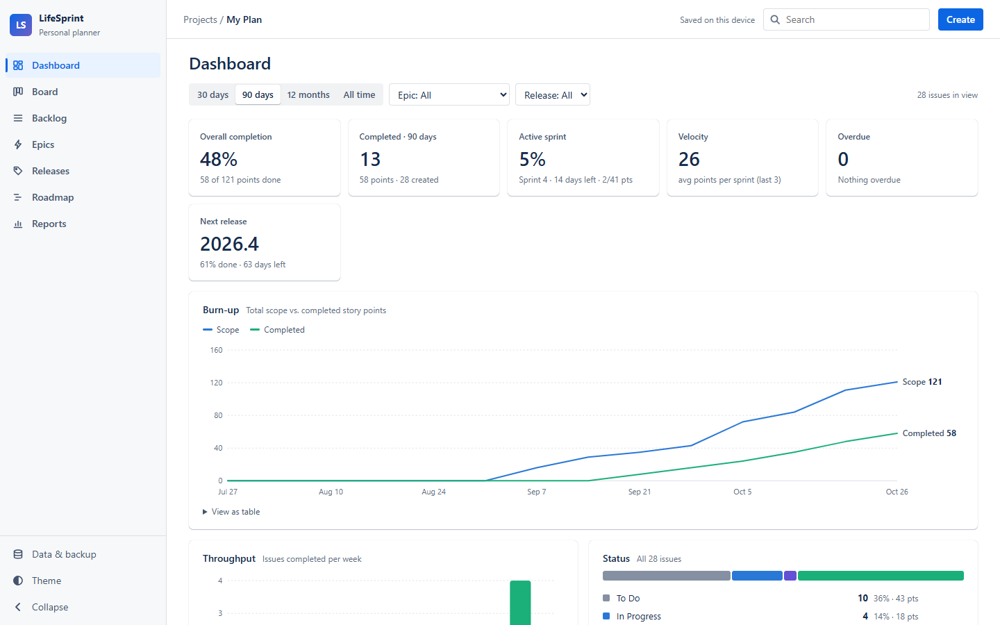
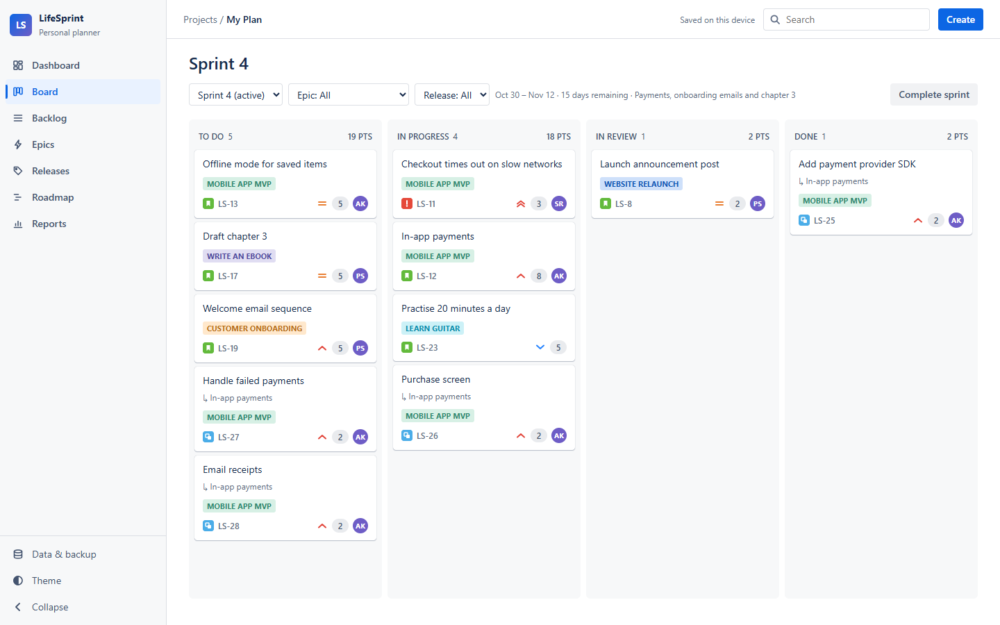
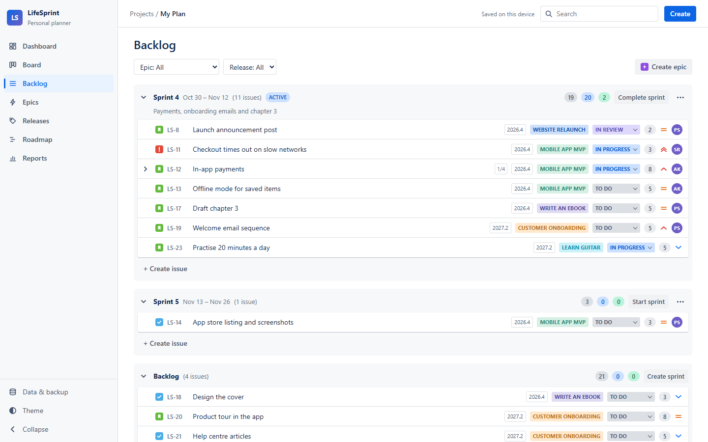
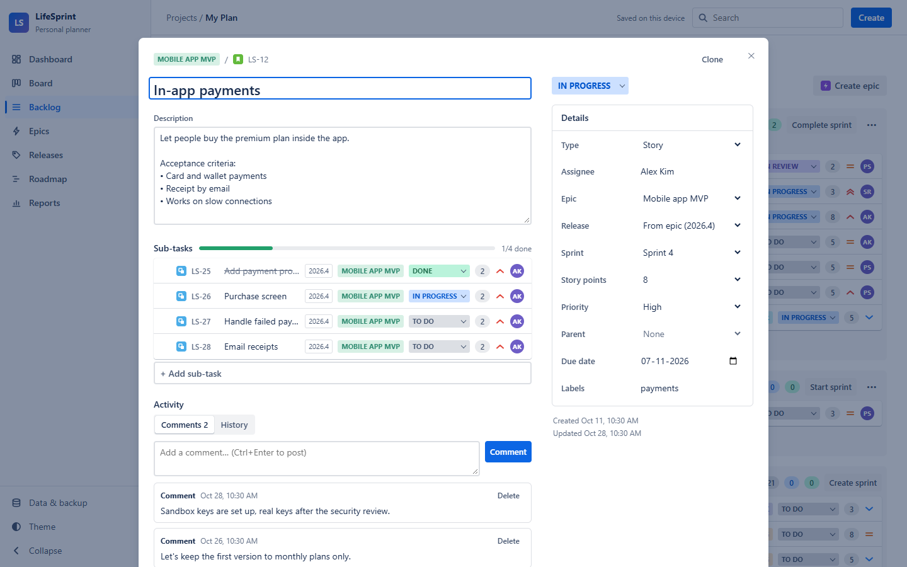
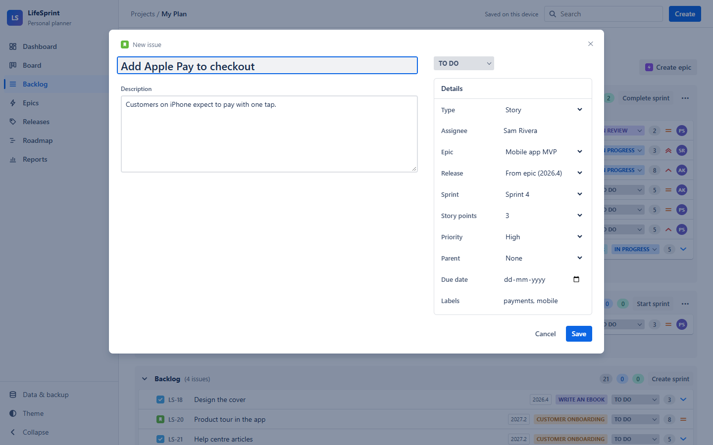
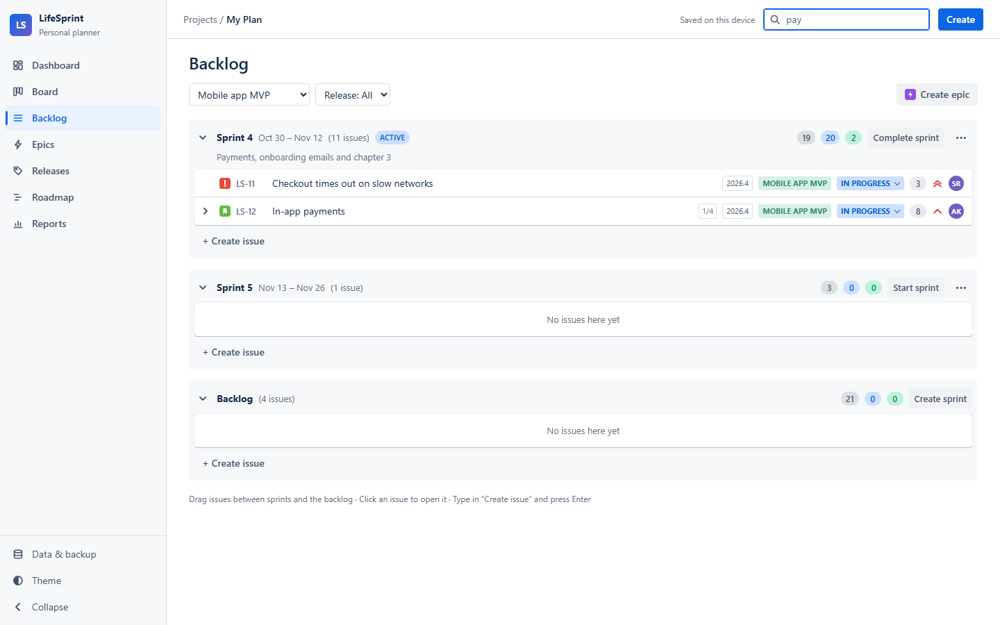
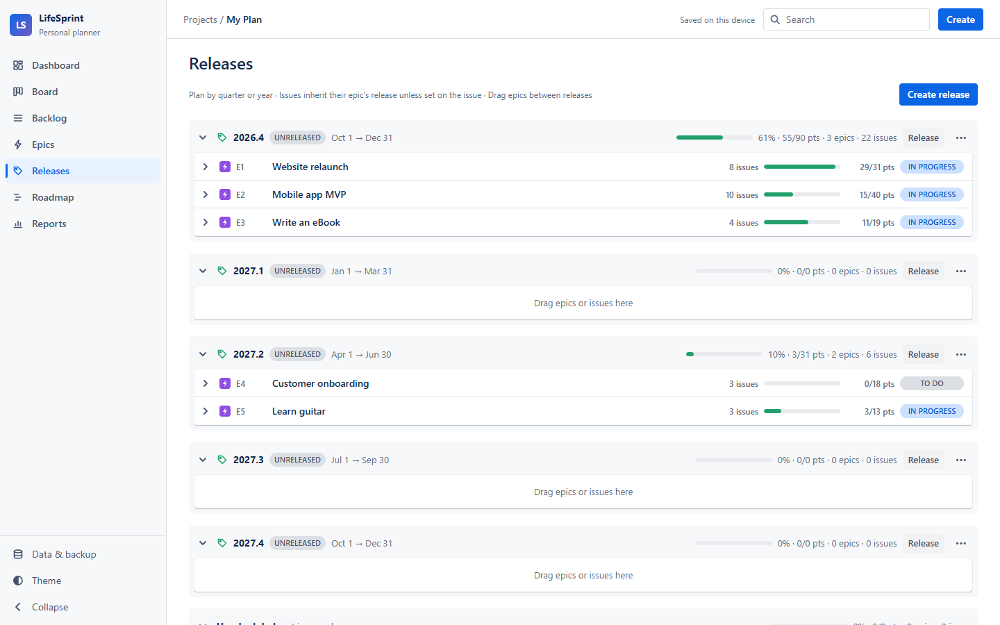
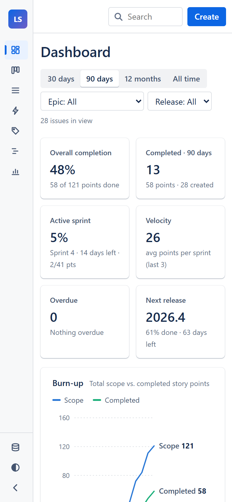

# LifeSprint

A planner for projects and personal goals that works offline. Plan work as epics, break it into stories, tasks and sub-tasks, run sprints, group work into quarterly releases, and see your progress on a dashboard.

No account, no server, no database. Your plan is saved in your own browser and never leaves your device.



## Features

- **Dashboard**: completion, active sprint, velocity, overdue work, next release, a burn-up chart, throughput, status and priority breakdowns, and progress by epic and release, filtered by time range, epic or release
- **Epics, stories, tasks, issues and sub-tasks** with status, story points, priority, assignee, due date and labels
- **Comments and history** on every issue: keep notes, and see what changed and when
- **Backlog** with sprints you can fold, drag-and-drop ranking and planning, and quick-add
- **Board** for the current sprint with drag-and-drop between To Do, In Progress, In Review and Done
- **Releases** (for example `2026.4`, `2027.1`): a Release → Epic → Story → Sub-task tree with progress totals
- **Roadmap** timeline, **Reports** (burndown, velocity)
- **Works offline and installs as an app** (Chrome, Edge and other Chromium browsers; Safari via *Add to Home Screen*)
- Clone issues, light and dark mode, works on phones, keyboard shortcuts (`C` to create, `/` to search, `Esc` to close)

## Application preview

Screenshots use a fictional demo plan.

### Board
The active sprint with cards grouped by status. Each card shows its epic, type, priority, story points and assignee.



### Backlog
Sprints and the backlog in rank order. Drag rows to reorder them or move them between sprints.



### Issue details
Description, sub-tasks with progress, comments and change history, with all fields in the side panel.



### Create an issue
Press **Create** (or `C`) to add a story, task or issue to any epic, sprint or release.



### Search and filters
Search by title, key, label or assignee, and filter by epic or release.



### Releases
Quarterly releases with epics, issue counts and progress in story points.



### On a phone
The layout adapts to narrow screens.



## Use it

**Hosted:** open the site and click **Install app** in the sidebar (or the install icon in the address bar). After the first visit it works without internet.

**On your own computer:** you need [Node.js](https://nodejs.org) 18 or newer.

```sh
node server.js
```

Then open http://localhost:4000. On Windows you can double-click `start.bat` instead.

## Your data

- Everything is saved in this browser's storage (IndexedDB) for this site. Different browsers and devices have separate plans.
- **Data & backup** in the sidebar lets you export a backup (`.json`), import one, or start over.
- Clearing this site's browser data deletes your plan, so export a backup now and then. The app reminds you after a lot of changes.
- To move your plan to another device, export it there and import it on the other one.

## Host it for free

The `public/` folder is the whole app: static files with no backend.

- **GitLab Pages:** push this repository to GitLab. The included `.gitlab-ci.yml` runs the tests and publishes `public/` from the default branch. Your site appears under *Deploy → Pages*.
- **GitHub Pages, Netlify, Cloudflare Pages:** publish the `public/` folder as a static site. No build step is needed.

## Tests

```sh
npm install   # only needed for the browser tests
npm test
```

- `tests/server.test.js` attacks the local server (path traversal, bad encodings, odd methods, many concurrent requests).
- `tests/store.test.js` feeds hostile, broken and old plans to the importer.
- `tests/e2e.test.js` drives the real app in headless Chrome or Edge. It checks script injection, comments and history, drag-to-reorder, import/export round trips, two windows open at once, offline mode, a 3000-issue plan, phone screens, and validation. It is skipped if no browser is found; set `CHROME_PATH` to point at one.

## Licence

MIT. See [LICENSE](LICENSE).
