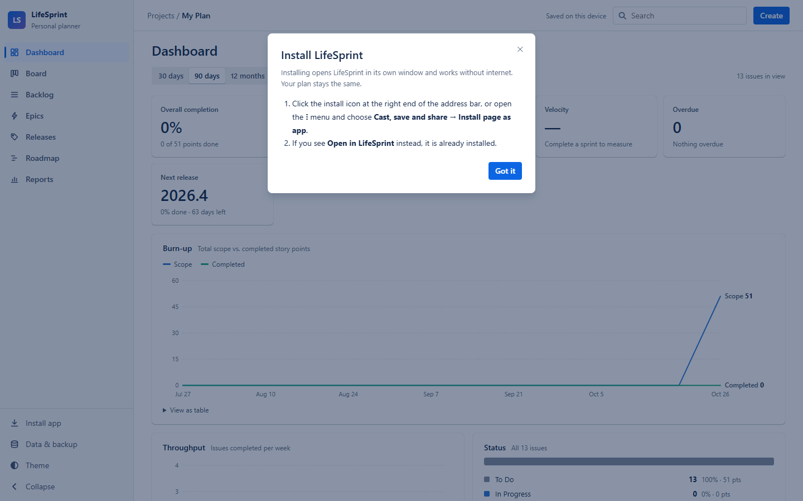

# LifeSprint

A planner for projects and personal goals that works offline. Plan work as epics, break it into stories, tasks and sub-tasks, run sprints, group work into quarterly releases, and see your progress on a dashboard.

No account, no server, no database. Your plan is saved in your own browser and never leaves your device.


## Features

- **Dashboard**: completion, active sprint, velocity, overdue work, next release, a burn-up chart, throughput, status and priority breakdowns, and progress by epic and release, filtered by time range, epic or release
- **Epics, stories, tasks, issues and sub-tasks** with status, story points, priority, assignee, due date and labels
- **Comments and history** on every issue: keep notes, and see what changed and when
- **Backlog** with sprints you can fold, drag-and-drop ranking and planning, and quick-add
- **Board** for the current sprint with drag-and-drop between To Do, In Progress, In Review and Done
- **Releases** (for example `2026.4`, `2027.1`): a Release → Epic → Story → Sub-task tree with progress totals
- **Roadmap** timeline, **Reports** (burndown, velocity)
- **Works offline and installs as an app** (Chrome, Edge and other Chromium browsers; Safari via *Add to Home Screen*)
- Clone issues, light and dark mode, works on phones, keyboard shortcuts (`C` to create, `/` to search, `Esc` to close)

## Application preview

Screenshots use a fictional demo plan.

### Board
The active sprint with cards grouped by status. Each card shows its epic, type, priority, story points and assignee.


### Backlog
Sprints and the backlog in rank order. Drag rows to reorder them or move them between sprints.


### Issue details
Description, sub-tasks with progress, comments and change history, with all fields in the side panel.


### Create an issue
Press **Create** (or `C`) to add a story, task or issue to any epic, sprint or release.


### Search and filters
Search by title, key, label or assignee, and filter by epic or release.


### Releases
Quarterly releases with epics, issue counts and progress in story points.


### On a phone
The layout adapts to narrow screens.


## Run it on your computer

You need [Node.js](https://nodejs.org) 18 or newer. There is nothing else to install: the app has no dependencies.

1. Get the code: clone the repository, or download it as a ZIP and unzip it.

   ```sh
   git clone https://github.com/Rajath652/lifesprint.git
   cd lifesprint
   ```

2. Start it:

   ```sh
   node server.js
   ```

   On Windows you can double-click `start.bat` instead. It starts the server and opens your browser.

3. Open http://localhost:4000 and choose **Start with an example plan**, **Start with an empty plan**, or **Import a backup file**.

To use a different port, run `PORT=5000 node server.js` (in PowerShell: `$env:PORT=5000; node server.js`). To stop the server, press `Ctrl+C` in its window.

## Install it as an app

LifeSprint can be installed so it opens in its own window, like a normal program, and works without internet.

1. Open LifeSprint in Chrome or Edge, on your computer (`localhost:4000`) or on a hosted copy.
2. Click **Install app** at the bottom of the sidebar and follow the steps. Depending on your browser:
   - **Chrome:** click the install icon at the right end of the address bar.
   - **Edge:** **…** menu → **Apps** → **Install this site as an app**.
   - **iPhone and iPad (Safari):** **Share** → **Add to Home Screen**.
3. Open LifeSprint from the Start menu, Dock or home screen from then on.



Each address keeps its own plan: the app installed from `localhost:4000` and one installed from a hosted copy have separate data. Use **Data & backup** to move a plan between them.

## Your data

- Everything is saved in this browser's storage (IndexedDB) for this site. Different browsers and devices have separate plans.
- **Data & backup** in the sidebar lets you export a backup (`.json`), import one, or start over.
- Clearing this site's browser data deletes your plan, so export a backup now and then. The app reminds you after a lot of changes.
- To move your plan to another device, export it there and import it on the other one.

## Host it for free

The `public/` folder is the whole app: static files with no backend.

- **GitLab Pages:** push this repository to GitLab. The included `.gitlab-ci.yml` runs the tests and publishes `public/` from the default branch. Your site appears under *Deploy → Pages*.
- **GitHub Pages, Netlify, Cloudflare Pages:** publish the `public/` folder as a static site. No build step is needed.

## Tests

```sh
npm install   # only needed for the browser tests
npm test
```

- `tests/server.test.js` attacks the local server (path traversal, bad encodings, odd methods, many concurrent requests).
- `tests/store.test.js` feeds hostile, broken and old plans to the importer.
- `tests/e2e.test.js` drives the real app in headless Chrome or Edge. It checks script injection, comments and history, drag-to-reorder, import/export round trips, two windows open at once, offline mode, a 3000-issue plan, phone screens, and validation. It is skipped if no browser is found; set `CHROME_PATH` to point at one.

## Licence

MIT. See [LICENSE](LICENSE).
